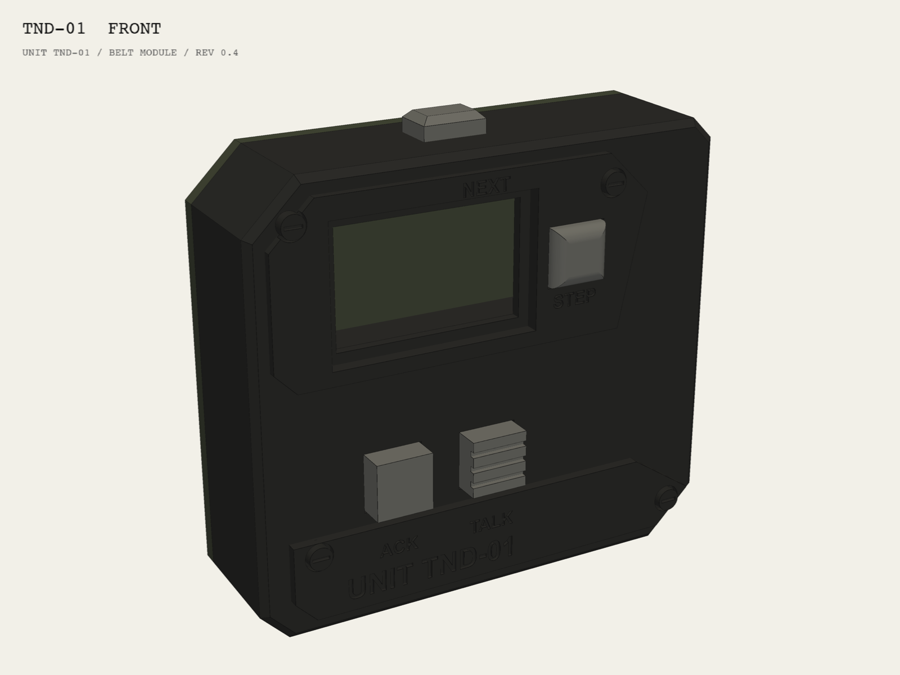
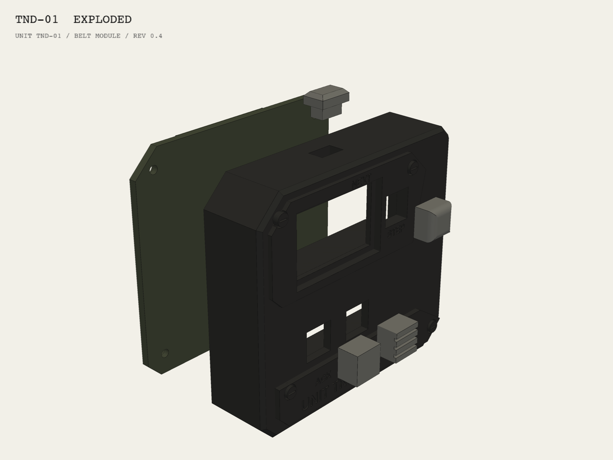

# tender-hardware

Enclosure, wiring and bill of materials for **TENDER TND-01** — a self-contained wearable unit for restaurant floor work. FIELD SERVICE UNIT.

Concept, functions, the Ink Industrial design language and the stage 0 shopping list live in [tender-vault](https://github.com/milvalen/tender-vault).



## Status

Rev 0.4 of the belt module enclosure (concept B). The geometry builds and passes the fit checks below. Not printed yet.

Stage 0 uses ready-made boards with snap-in Grove connectors: no soldering. Print the front shell and the key caps in SLA resin (sharp plate edges, 0.4 mm engraving) and the back cover in PA12 nylon (MJF or SLS) for the spring clip.

## Enclosure rev 0.4

| | |
|---|---|
| Payload | M5Stack StickS3 (K150), 48 × 24 × 15 mm, lying landscape. M5Stack Unit Dual Button (U025), 48 × 24 × 15 mm with its keys, in the lower bay |
| Shell | 68 × 62 × 20.6 mm; 68 × 65 × 31.3 mm with the belt clip and the `NEXT` pusher |
| Parts | `front_shell`, `back_cover` (with spring belt clip), `key_step` (over StickS3 key A), `key_next` (pusher on the top face, over StickS3 key B), `key_ack` (flat) and `key_talk` (ribbed) over the Dual Button keys |
| Belt clip | 30 mm wide, 46 mm long, tongue 2.6 mm, gap 2 mm. Takes belts up to 4.5 mm; `build.py` checks the root strain against a 2 % limit |
| Markings | `UNIT TND-01` and the key functions `STEP`, `NEXT`, `ACK`, `TALK`, engraved 0.4 mm. Fill the engraving with white paint after the print |
| Fasteners | 4 × M2 × 16 self-tapping screws, back cover into front shell |
| Lower bay | 48.6 × 24.6 mm for the Dual Button unit |
| Cable bay | 9.4 mm wide, at the right end: both Grove plugs and a 5–10 cm Grove cable. A 20 cm cable does not fit |

Before the print:

- Board sizes come from the maker drawings. Values marked `[?]` in `enclosure/params.py` are not measured: StickS3 key B height, USB-C plug body size, cable bay length, thickest belt. Measure the real boards with calipers and update them.
- Plug the USB-C cable and the Grove cable into the StickS3 at the same time: the plugs must not touch in the cable bay.
- Key B of the StickS3 must face up, toward the top pusher. If it faces down, turn the board and set display rotation 3 in the firmware.
- The vibration module has no place in the enclosure yet.
- The thumb wheel and the separate talk button are off (`Controls.wheel`, `Controls.talk`). The visor is off (`Plates.visor`).



## Usage

Requires Python ≥ 3.10. With [uv](https://docs.astral.sh/uv/):

```bash
uv venv --python 3.12 .venv
uv pip install --python .venv/bin/python build123d pyvista
.venv/bin/python enclosure/build.py     # checks + STEP/STL to out/
.venv/bin/python enclosure/render.py    # previews to renders/
```

`build.py` checks that every part is a valid solid, that the shell does not overlap the boards, that keys do not collide with the shell or press into the boards, that each screw has wall around it, the cable bay width and the belt clip strain. It exits with status 1 on a failure.

It also checks the cable plugs at the right end of the StickS3: the USB-C overmold must not touch the Grove plug or the shell, and the Grove plug with its cable bend must fit in the cable bay. The plug sizes in `Plugs` are guesses, so a plug problem is a `WARN` until `Plugs.measured` is set to `True` after the measurements.

Before the export, `build.py` removes the old `tnd01_*.stl` and `tnd01_*.step` files from the output folder. `out/` then holds only the parts of the current revision.

Change dimensions in `enclosure/params.py`, not in the model code.

## Layout

| Path | Contents |
|---|---|
| `enclosure/params.py` | All dimensions |
| `enclosure/tnd01_belt.py` | Parametric model (build123d) |
| `enclosure/build.py` | Fit checks and STEP/STL export to `out/` |
| `enclosure/render.py` | Preview renders to `renders/` |
| `exports/` | Released STEP/STL files (tagged releases only) |

## Branches

`dev` is the default branch. `main` is the release branch and is never ahead of `dev`. Agents work in `ai/<area>` branches and merge them into `feature/<area>`. The owner reviews and accepts the work on `feature/<area>`; then it is merged into `dev`.
